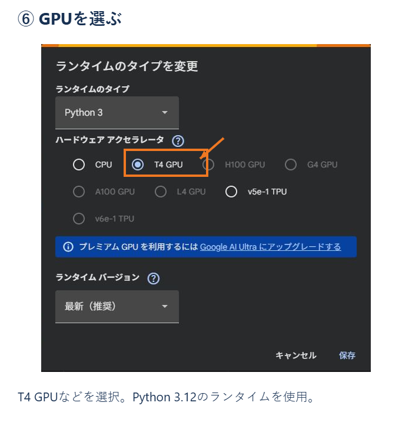

# Colab版73Botの使い方

## 初回：Discord BOTを用意する

[画像付きのDiscord BOT準備ガイド](discord-setup.md)に従って、アプリ作成・Message Content Intent・サーバー招待・トークン登録を行います。
同じ案内をColabノートブックの最初にも掲載しています。

必要なものはGPUを利用できるGoogle Colab、Discord BOTを導入できるサーバー、自分の録音（または声の再現に使う許可を得た録音）です。
Google Driveの接続は不要です。Python 3.12、モデルは `Qwen/Qwen3-TTS-12Hz-0.6B-Base` を使用します。
無料ColabのGPU割り当てや実行時間は保証されません。必要時に手動起動します。[Colab公式FAQ](https://research.google.com/colaboratory/faq.html)

## 毎回：開く・準備する・アップロードする

1. [Google Colabでノートブックを開く](https://colab.research.google.com/github/Gai-b63a/73Bot/blob/master/notebooks/73Bot_Colab.ipynb)。必要なら自分のDriveにノートブックをコピーできますが、保存場所は自由です。
2. 「ランタイム → ランタイムのタイプを変更」でGPUを選びます。
3. 左の鍵アイコンで `DISCORD_BOT_TOKEN` のノートブックアクセスがオンになっていることを確認します。
4. 「準備して操作画面を開く」左の▶を押し、準備が終わるまで待ちます。コードの編集や取得先・保存先の指定は不要です。
5. 操作画面で音声をアップロードします。先頭10秒が自動で見本として選ばれ、短い録音は全体を使います。見本の音声が表示されます。
6. 「試聴」を押し、終了後に自動表示される音声を聞きます。「BOTを起動」を押し、状態が「BOT稼働中」になるまで待ちます。
7. DiscordでVCへ入り、読むテキストチャンネルで `/join` を実行します。

Python 3.12以外の場合は「過去のランタイム」から対応版（例：2026.07）を選びます。[Colabのランタイム情報](https://research.google.com/colaboratory/runtime-version-faq.html)
コードの取得先はこのリポジトリの `master` に固定しています。モデルとライブラリの準備は自動で行います。
新しいセッションで最初に試聴・起動するときは、モデルのダウンロードとウォームアップにも時間がかかります。
準備中にエラーが出たら、画面の案内を確認してください。通常は非表示のセットアップログを、失敗時の「エラーの詳細」から確認できます。

## 停止・再起動・声の変更

終了するときは「停止」を押します。同じセッションではアップロードした音声と設定を再利用して起動できます。
声を変更するときは「停止 → 別の音声をアップロード → 試聴 → BOTを起動」です。Discord利用者は声を変更できません。
準備セルを再実行しても同じ管理画面と処理を再利用し、音声を消したり二重起動したりしません。
試聴・測定・BOTは同時に実行できません。起動中は音声と設定を変更できません。

録音・設定・モデル・生成音声・測定結果はColabの一時領域に保存されます。
新しいセッションではモデルを再取得し、音声を再アップロードします。ノートブックをDriveにコピーしてもこれらのデータは保存されません。
以前の版でDriveに保存したプリセットは、この画面では読み込みません。既存のDriveデータは変更しません。

## 詳細設定

「詳細設定・測定・ログ」を開くと、切り出し開始・終了秒、任意の書き起こし、試聴文、音量、読み辞書を調整できます。
音声の名前や保存操作は不要です。設定は試聴・測定・BOT起動時に反映されます。

- 見本は3〜30秒。ノイズや言い直しの少ない5〜15秒を推奨します。「見本の区間を確認」で選んだ区間を再生できます。
- 切り出し時はモノラル24kHz WAVに変換します。元の録音は変更しません。
- 書き起こしは任意。空欄なら録音だけで声の特徴を使い、入力時は録音と文章を使います。文章は見本で実際に話している内容と一致させてください。
- 読み辞書は `{"73Bot": "ななみボット", "HP": "エイチピー"}` のようなJSON形式です。

録音だけの方式は声の再現品質が下がる可能性があるため、試聴して確認してください。[Qwen公式の説明](https://github.com/QwenLM/Qwen3-TTS#voice-clone)

## Discordの操作

| コマンド | 動作 |
|---|---|
| `/join` | 実行したテキストチャンネルを読む。同じVCから監視先を変更可能 |
| `/leave` | 読み上げと待ち行列を終了して退出 |
| `/skip` | 現在の投稿の残りを飛ばす |
| `/clear` | 未再生の投稿を消す。現在の投稿の残りは読む |
| `/status` | 接続、声、待ち件数、音声生成状態を表示 |

再生操作はBOTと同じVCの参加者のみ行えます。人がいなくなると退出します。再起動後は `/join` をやり直してください。
各サーバーで1つのVCと監視チャンネルに対応し、全サーバーで共通の声と1つのGPUワーカーを使います。

## 測定と結果の保存

ローカルGPU試験では、短文3例の生成が書き起こしありで5.2〜15.2秒、なしで8.5〜16.8秒となり、5秒目標は未達でした。
本人の声を使った無料Colab・Discord VCの通し検証は未実施です。[検証記録](validation.md)

「20例×3回の測定」はウォームアップ後に固定20例を3回生成し、音声・平均・95パーセンタイル・最大値・GPUメモリを記録します。
BOTでは `idle_first_packet_seconds`（待ち行列なし）、`queued_first_packet_seconds`（待ち行列あり）、`generation_seconds` を区別して記録します。
5秒を超える回があれば `all_within_5s: false`、未測定なら `null` です。送信開始と耳で聞こえるまでの時間も区別します。
通常投稿の本文やトークンは測定ログに保存しません。

停止後に「測定結果をダウンロード」を押すと、試聴・測定・BOTの結果をZIPで保存できます。試聴・測定の生成音声も含まれます。
セッションを削除すると未ダウンロードの結果は失われます。録音や生成音声を含む結果を公開Issueに添付しないでください。

## トラブル時

- **GPUなし**：GPUランタイムを選び直します。無料枠で確保できない場合は後で再試行します。
- **トークンなし・アクセス拒否**：シークレット名とノートブックへのアクセス許可を確認します。
- **録音が短い・無音・読み込めない**：別の録音をアップロードするか、詳細設定で切り出し区間を調整します。
- **起動中で操作できない**：先に停止してください。状態は自動更新されます。
- **VCに接続できない・投稿を読まない**：Message Content Intentと、対象チャンネルの閲覧・送信・接続・発言権限を確認します。
- **GPUメモリ不足・生成タイムアウト**：詳細ログを確認し、停止後に再起動します。1区間60秒超やワーカー異常でも読み上げは止まります。
- **停止ボタンが使えない**：ランタイムを中断し、それでも停止できなければ「接続を解除して削除」を使用します。

待ち行列はサーバーごとに最大100投稿、投稿順に再生します。URL・メンションを整形し、コードブロック・DM・BOT投稿・本文なしの投稿は読みません。
5秒を超えても読み上げます。他モデルやCPUへ自動では切り替えません。
