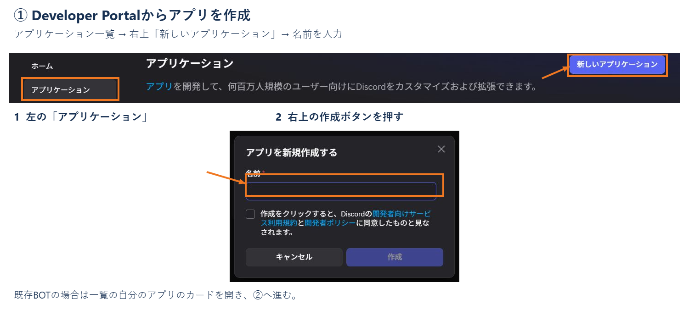
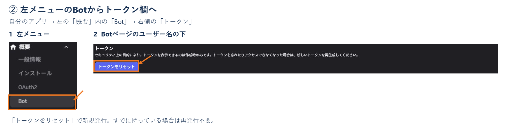
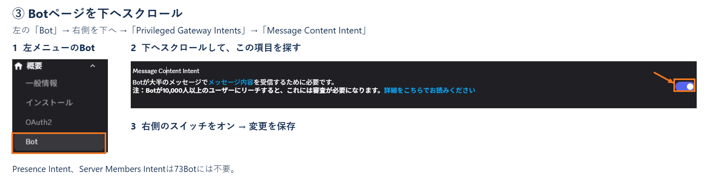
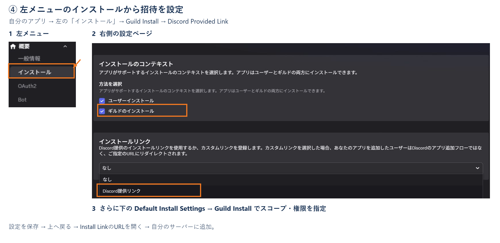
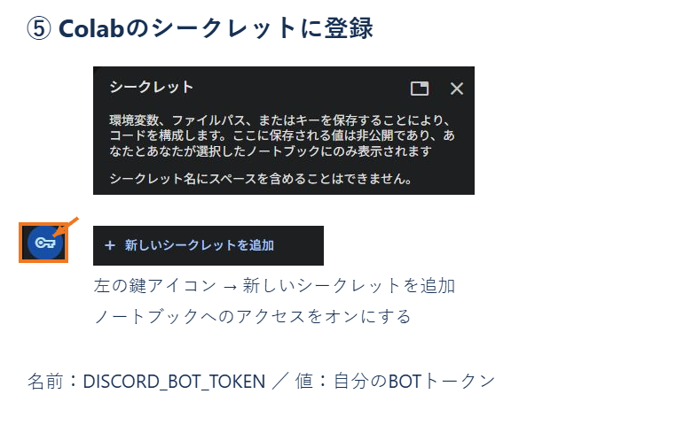

# 1. Discord BOTの準備（初回だけ）

Discord BOTは、Discordに参加する読み上げ用アカウントです。以下の操作はBOTを作成する人が行います。
画面の言語により日本語／英語の名前が異なります。

## ① Developer Portalから自分のアプリを開く

**入口：Discord Developer Portal → 左の「アプリケーション / Applications」**

ここは、作成したBOTのアプリを一覧で選ぶ画面です。Discordのサーバー設定画面とは別です。

1. [アプリケーション一覧を開く](https://discord.com/developers/applications)。ログインが必要ならDiscordのアカウントでログインします。
2. 新しく作る場合は、画面右上の「新しいアプリケーション / New Application」を押します。
3. 名前を入力して作成すると、そのアプリの設定画面に移動します。

すでにBOTを作ってある場合は、一覧の「マイアプリケーション / My Applications」にある**自分のアプリのカード**をクリックしてください。
アプリを開くと、左メニューが「一般情報」「インストール」「OAuth2」「Bot」などに変わります。
最初に表示される「一般情報 / General Information」は、今回の読み上げ設定をする場所ではありません。

### 新しく作る場合

名前（例：73Bot）を入力し、利用規約を確認して同意し、「作成 / Create」を押します。

## ② BOTのトークンを取得する

**道順：アプリケーション一覧 → 自分のアプリ → 左の「概要 / Settings」内の「Bot」→「トークン / Token」**

1. アプリの設定画面の**左メニューにある「Bot」**を押します。「OAuth2」と「絵文字」の間にあります。
2. 右側が「Bot」ページになったら、「ユーザー名 / Username」の下にある「トークン / Token」を探します。
3. 「トークンをリセット / Reset Token」で発行されるトークンをコピーします。
二段階認証を求められたら自分で認証してください。既存BOTのトークンを作り直した場合、以前のトークンは使えなくなります。
すでにトークンを保存している場合は再発行せず、そのトークンを使えます。

**トークンはBOTのパスワードです。チャットやIssue、コードセル、画像に載せないでください。**
取得したトークンは⑤でColabのシークレットに登録します。「Application ID」「Public Key」はトークンとは別のものです。

## ③ 投稿を読めるようにする

**道順：左の「Bot」→ 右側のページを下へスクロール →「Privileged Gateway Intents」→「Message Content Intent」**

1. ②と同じ「Bot」ページに留まり、**右側の設定ページ**を下へスクロールします。
2. 「Privileged Gateway Intents」という見出しを探します。トークン欄より下にあります。
3. その中の「Presence Intent」「Server Members Intent」に続く、**Message Content Intent** の右側のスイッチをオンにします。
「変更を保存 / Save Changes」が表示されたら押してください。Presence IntentとServer Members Intentは、このBOTには不要です。

## ④ BOTをサーバーに招待する

**道順：同じアプリの左メニュー「インストール / Installation」→「インストールのコンテキスト / Installation Contexts」→「インストールリンク / Install Link」→「Default Install Settings」**

1. 左メニューの**「インストール / Installation」**を押します。「一般情報」のすぐ下、「OAuth2」のすぐ上です。
2. 右側の「インストールのコンテキスト / Installation Contexts」で **Guild Install（ギルドのインストール）** を選びます。
3. 少し下の「インストールリンク / Install Link」の選択欄を開き、**Discord Provided Link（Discord提供リンク）** を選びます。
4. さらに下へスクロールし、「Default Install Settings」の **Guild Install** の欄で、次のScopesとPermissionsを設定します。
   この欄が表示されない場合は、手順3で「なし / None」ではなく「Discord提供リンク」を選んでいるか確認してください。

- Scopes：`applications.commands` と `bot`
- Permissions：`View Channels`（チャンネルを表示）、`Send Messages`（メッセージを送る）、`Connect`（接続）、`Speak`（発言）

設定を保存したら、同じページの上に戻り、「Install Link」に表示されるURLをコピーしてブラウザで開きます。「サーバーに追加」を選び、自分が管理できるサーバーに招待してください。
このBOTはサーバーへのインストールを使います。「自分のアプリに追加」は使用しません。
招待した直後はオフラインで正常です。Colabで「BOTを起動」を押してからオンラインになります。
対象チャンネルで上記の権限が個別に拒否されていないことも確認してください。

## ⑤ Colabのシークレットにトークンを登録する

Colab左側の鍵アイコン「シークレット / Secrets」を開き、「新しいシークレットを追加」を押します。

- 名前：`DISCORD_BOT_TOKEN`（この名前をそのまま入力）
- 値：②でコピーしたBOTトークン
- ノートブックへのアクセス：オン

トークンをコードセルに貼り付ける必要はありません。登録済みなら、名前とノートブックへのアクセス許可を確認するだけです。
同じトークンで別のBOTを動かしている場合は、先にそちらを停止してください。

参考：[Discord公式のBOT作成手順](https://github.com/discord/discord-api-docs/blob/main/developers/quick-start/getting-started.mdx)。
73BotはColabからDiscordに接続するため、公開サーバーやInteractions Endpoint URLの設定は不要です。
